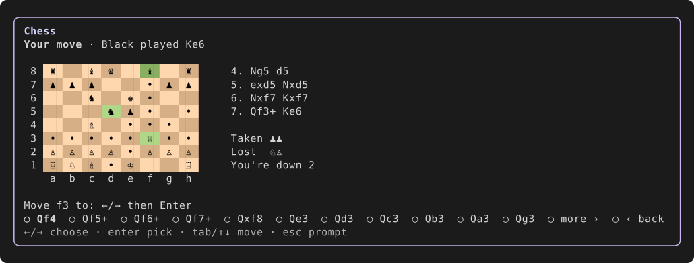

# LLMChess

Play chess against your Command Code session's LLM while the agent works. The
board stays in a live pane above the prompt, you move with the arrow keys, and
the LLM answers through one model call that never touches the agent's
transcript. A built-in engine plays alongside it: pick it as your opponent, or
let it step in whenever the LLM can't answer with a legal move.



Zero runtime dependencies. Same idea as
[token-snake](https://github.com/vipulgupta2048/token-snake), but as a mod: no
second terminal pane, and chess is turn based, so it fits between agent steps.

## Try it

Needs Command Code 1.85 or later, for mod panes.

```bash
# Install it for every session, from npm
cmd mods add cmd-mod-llmchess -g

# Or straight from GitHub
cmd mods add vipulgupta2048/token-chess -g

# Or try it for one session from a clone
git clone https://github.com/vipulgupta2048/token-chess
cmd --mod ./token-chess/index.ts
```

Then, at any time, including while the agent is mid-turn, run `/chess`. The
board opens with one control under it, driven by ←/→ and Enter:

1. Choose a piece.
2. Choose its square. Dots mark where it can go, and captures light up.

New game, Settings and Resign are under `≡ menu` at the end of the list. When
the pieces don't fit on one line, `more ›` at the end shows the next ones.

Over the board, the headline says what just happened, by name: "You played
e4", "DeepSeek V4.1 Flash took your knight (Nxe4)". The line under it shows a
spinner and a timer while the model thinks, then its one-line comment on its
move. When a model's move throws away a piece or walks into mate, the headline
calls it out in red: "blundered its queen ?? (Qh4)". At the end of a game, a
toast says how it went.

`/chess settings` picks who you play in one step: your session LLM, or the
built-in engine at level 1 to 5.

Esc hands the keyboard back to the prompt, and `/chess` or Ctrl+T returns to
the board. `/chess close` hides it. While the board is open, the footer stays
quiet, since the board's headline already says whose move it is.

Everything also works from the prompt:

| Command | What it does |
|---|---|
| `e4`, `Nf3`, `exd5`, `O-O`, `e8=Q` | Play a move in SAN |
| `e2e4`, `e2 e4`, `e2-e4`, `Ng1f3` | The same by squares. Case doesn't matter, `oo` castles, and a promotion with no piece makes a queen |
| `new [black] [engine]` | New game. You play white against your session LLM unless you say otherwise |
| `settings` | Pick your opponent: your session LLM, or the engine at a level |
| `vs llm`, `vs engine` | Switch who plays against you, mid-game too |
| `undo` | Take back your last move and the reply |
| `level <1-5>` | Engine strength, default 3. It is also how strong the LLM's stand-in is |
| `resign` | Give up the current game |
| `close` | Hide the board. Ctrl+T or `/chess` brings it back |
| `help` | The list above |

An illegal move is answered in terms of the piece you named: `Nd5` gets "no
knight can reach d5" and that piece's legal moves. The game is saved to
`~/.commandcode/llmchess/game.json`, so it survives `/reload` and new sessions.
On a host without panes, each turn prints a board in the feed instead.

## Playing the LLM

Each LLM move is one `cmd.model.complete` call on your session's model, with no
tools and no transcript, so it can't derail the work you're waiting on. The
prompt holds the moves so far, the position as FEN, and the full list of legal
moves, and asks for one move back, plus an optional remark of a dozen words.

- **Legal moves only.** The answer must name a legal move. If it doesn't, the
  LLM is asked once more with the reason. If that fails too, the engine plays
  the move instead and the pane says why.
- **The engine stands in** whenever the model is unavailable, the call fails,
  or it takes over a minute.
- **It costs credits.** Every LLM move is billed like any other request in
  your session. Switch to the engine with `/chess vs engine` to play for free.
- **It plays like an LLM.** Expect personality more than precision. The
  built-in engine at level 3 or more is usually the stronger player.
- **Switch any time.** `/chess settings` or `/chess vs engine` hands the
  current game to the engine, and `/chess vs llm` hands it back.

Games saved before LLMChess had an LLM opponent keep playing the engine.

## How it compares

Standalone terminal chess apps such as
[gambit](https://github.com/maaslalani/gambit),
[chess-tui](https://github.com/thomas-mauran/chess-tui) and
[cli-chess](https://github.com/trevorbayless/cli-chess) take over the terminal
and do more: online play, Stockfish, themes. LLMChess is for the minutes an
agent is working, so it lives in a pane beside your prompt instead.

| | LLMChess | Standalone TUI apps |
|---|---|---|
| Runs | In a Command Code pane, while the agent works | In their own terminal window |
| Opponent | Your session LLM, or a built-in engine with 5 levels | Stockfish or another UCI engine, Lichess |
| Moves | ←/→ and Enter, or typed SAN and squares | Cursor, mouse, or typed |
| Legal-move hints | Dots and lit captures after picking a piece | Most |
| Install | One `cmd mods add` | Cargo, Go, pip or a package manager |

## What it can reach

Your session's model, one call per LLM move. `cmd mods inspect` also reports
the filesystem, for the saved game. Nothing else: no network of its own, no
processes, no hooks on the agent's work.

## How it fits the mod API

| Need | Seam |
|---|---|
| Play the session's LLM | `cmd.model.complete`, aborted when a new game or resignation replaces the board |
| Take moves while the agent runs | A `select` or `input` element in the pane, or `cmd.addCommand`. Both run while the agent is working |
| Draw the board | `cmd.ui.pane`, line based ANSI rows repainted with `refreshWidgets`. `cmd.addRenderer` + `cmd.showEntry` where panes aren't available |
| Reach the board from the prompt | `cmd.addShortcut('ctrl+t')`. Ctrl, because macOS terminals pass Alt chords on only with "Option as Meta" |
| Keep the game visible | `cmd.ui.setStatus`, one footer segment while the board is closed: `♙ LLMChess · your move · last Nf6`. A closed pane is never drawn, so a redraw every two seconds tells when the board closed |
| Offer a game while you wait | `cmd.on('run_start')` sets `♙ /chess to play while you wait` when no game is going |
| Resume a saved game | `cmd.hooks({onSessionStart})` |
| Pick the opponent | `cmd.ui.select`, Command Code's own dialog, from `/chess settings` |

## The built-in engine

Iterative deepening negamax with alpha-beta, check extensions, a quiescence
search over captures and check evasions, repetition awareness, and MVV-LVA
ordering. The evaluation is Michniewski's material plus piece-square tables,
with tapered king tables, passed pawns, and a push toward mate in won endings.
The search is bounded by a node budget instead of a clock, so the same
position, game history and level always get the same reply on any machine. It
runs in the TUI process and yields to the event loop between root moves, so the
agent's stream keeps painting.

Measured on a busy middlegame (kiwipete):

| Level | Depth | Node budget | Think time | Longest UI stall |
|---|---|---|---|---|
| 1 | 1 | Always finishes depth 1 | ~0.1 s | ~35 ms |
| 2 | 2 | 10,000 | ~0.2 s | ~30 ms |
| 3 (default) | 3 | 30,000 | ~0.5 s | ~160 ms |
| 4 | 4 | 60,000 | ~1.2 s | ~190 ms |
| 5 | 5 (reached 4 here) | 120,000 | ~2.4 s | ~185 ms |

Move generation is checked with perft against the published reference counts
for the start position, kiwipete, and positions 3 to 5 (castling through
check, en passant pins, promotions, discovered checks).

## Not yet

- **A cursor on the board.** Mod shortcuts need Ctrl or Alt, a pane only takes
  buttons, inputs and selects, and a select doesn't report its highlight until
  Enter, so the picker can't preview a piece before you choose it.
- **The pane's key hints.** Command Code draws "Mod pane focused · Tab to
  move…" under every focused pane, and no mod can hide it. Tab does nothing
  here, since the pane has one control.
- **Scrolling the picker.** A pane's select wraps ←/→ inside the options it
  shows and tells the mod nothing until Enter, so long lists page with
  `more ›` instead of scrolling as you move.
- **The desktop app.** It draws panes, but can't focus a select and drops the
  board's colors, so play in the terminal.

## Develop

```bash
pnpm install
pnpm test        # perft, SAN, rules, engine, LLM replies, and the mod through a stub of the mod API
pnpm typecheck
```

`src/mod-api.ts` declares the slice of Command Code's `ModApi` this mod uses,
so the project typechecks on its own. The mod has no runtime dependencies; the
dev dependencies are only for the tests.

## License

MIT
