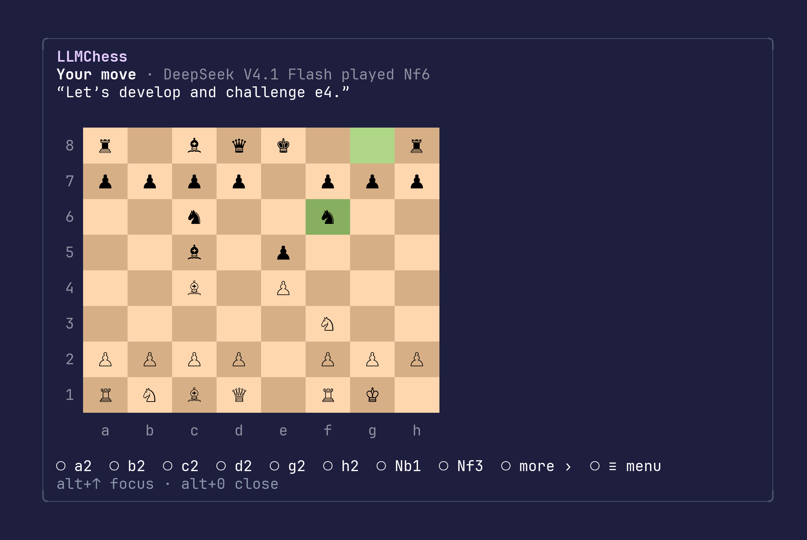

# LLMChess

Play chess against your Command Code model while the agent works. The board
sits in a pane above your prompt, so you can play a move, check on the agent,
and come back.



## Install

Needs Command Code 1.85 or later.

```bash
cmd mods add cmd-mod-llmchess -g
```

## Play

Run `/chess` at any time, even while the agent is mid-turn.

1. Pick a piece with ←/→ and Enter.
2. Pick its square. Dots show where it can go, and captures light up.

The model replies with its move and a one-line comment, like “A classic
Italian setup, let's keep it sharp!” If it blunders a piece, you'll see it in red. New game, Settings and
Resign are under `≡ menu`.

Esc goes back to your prompt. `/chess` or Ctrl+T brings the board back, and
`/chess close` hides it. Your game is saved, so it survives `/reload` and new
sessions.

## Commands

You can also type moves and commands after `/chess`:

| Command | What it does |
|---|---|
| `e4`, `Nf3`, `O-O`, `e2e4` | Play a move |
| `new [black] [engine]` | Start a new game |
| `settings` | Choose your opponent |
| `vs llm`, `vs engine` | Switch opponents, even mid-game |
| `undo` | Take back your last move |
| `level <1-5>` | Set the engine's strength (default 3) |
| `resign` | Give up the game |
| `close` | Hide the board |
| `help` | Show all commands |

## Good to know

- **Each model move uses credits**, like any other request. Play the built-in
  engine with `/chess vs engine` for free.
- **The model plays like an LLM**: plenty of personality, not much precision.
  The engine at level 3 or above is usually stronger.
- **It never gets in the agent's way.** Model moves are separate calls with no
  tools and no access to your conversation.
- **The engine fills in** when the model makes an illegal move, fails, or is
  unavailable. The board tells you when that happens.
- **It only touches** your session's model and one save file,
  `~/.commandcode/llmchess/game.json`. No network calls of its own.
- **Play in the terminal.** The desktop app shows the board without colors and
  can't use the move picker yet.

## Develop

```bash
pnpm install
pnpm test
pnpm typecheck
```

## License

MIT
